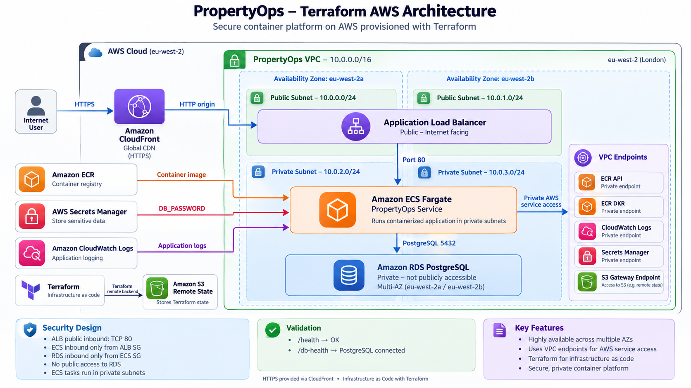
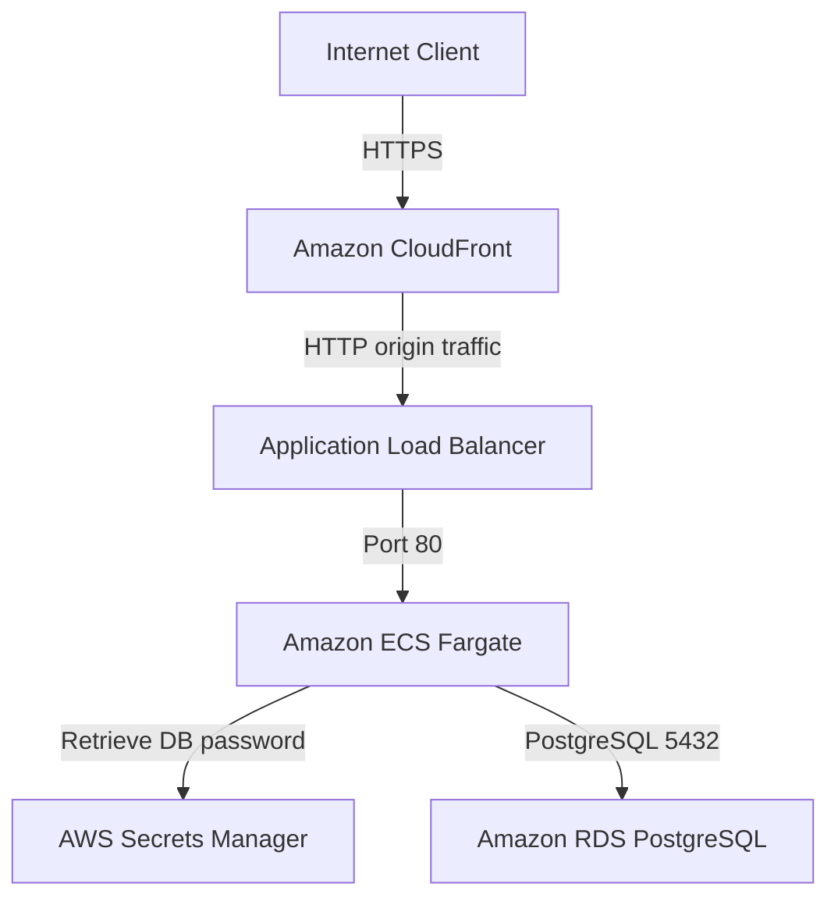

# PropertyOps — AWS Infrastructure with Terraform
[](https://github.com/Khalifa-12/propertyops-terraform/actions/workflows/terraform-ci.yml)
PropertyOps is a cloud infrastructure portfolio project that provisions a secure, container-based application platform on AWS using **Terraform**.

The project is the Infrastructure-as-Code evolution of my original PropertyOps ClickOps deployment. I first built the architecture manually in the AWS Console to understand how each service connected, then rebuilt the environment from scratch using reusable Terraform modules.

The platform demonstrates AWS networking, container orchestration, infrastructure as code, private service connectivity, secrets management, PostgreSQL, remote Terraform state and HTTPS delivery through CloudFront.

---

## Why I built this

I wanted to build an AWS project that went beyond:

```text
Create an EC2 instance
+
Deploy an application
+
Take a screenshot
```

The goal was to understand the complete path from infrastructure definition to a working application:

```text
Terraform
    |
    v
AWS Networking
    |
    v
CloudFront
    |
    v
Application Load Balancer
    |
    v
ECS Fargate
    |
    v
Secrets Manager
    |
    v
Amazon RDS PostgreSQL
```

I originally deployed PropertyOps manually using the AWS Console.

After proving the architecture worked, I rebuilt it using Terraform so that the environment could be recreated consistently, reviewed as code, version controlled and destroyed when not required.

---

## Project evolution

PropertyOps was intentionally completed in two stages.

### Stage 1 — ClickOps

The original environment was created manually through the AWS Management Console.

This helped me understand:

- VPC networking
- subnet design
- route tables
- security groups
- ECS task networking
- ALB target groups
- ECR image deployment
- RDS connectivity
- VPC endpoints
- Secrets Manager
- CloudFront

The ClickOps project is documented separately:

**[PropertyOps ClickOps Repository](https://github.com/Khalifa-12/propertyops-aws-clickops)**

### Stage 2 — Terraform

The same architecture was then rebuilt using modular Terraform.

The Terraform version improves the project by providing:

- repeatable infrastructure
- reusable modules
- remote state
- configuration validation
- infrastructure dependency management
- safe teardown and recreation
- version-controlled infrastructure

---

## What the platform includes

- Amazon VPC
- Two Availability Zones
- Public and private subnets
- Internet Gateway
- Public and private route tables
- Application Load Balancer
- Amazon ECS Fargate
- Amazon ECR
- Amazon RDS PostgreSQL
- AWS Secrets Manager
- Amazon CloudWatch Logs
- Amazon CloudFront
- S3 remote Terraform state
- Terraform state locking
- VPC interface endpoints
- S3 gateway endpoint
- Security-group based service isolation

The environment runs in:

```text
eu-west-2
```

---

## Architecture

The primary application path is:



CloudFront provides the public HTTPS endpoint using the AWS-provided `cloudfront.net` domain.

The ALB is currently used as an HTTP origin behind CloudFront.

For a production system I would use a custom domain and TLS between CloudFront and the origin as well.

---

## Network design

The VPC spans two Availability Zones:

```text
PropertyOps VPC
10.0.0.0/16

eu-west-2a
├── Public subnet
│   └── 10.0.0.0/24
│
└── Private subnet
    └── 10.0.2.0/24


eu-west-2b
├── Public subnet
│   └── 10.0.1.0/24
│
└── Private subnet
    └── 10.0.3.0/24
```

The Application Load Balancer runs across the public subnets.

ECS tasks and RDS run in private subnets.

---

## Cost-aware private networking

A key design decision was to avoid NAT Gateways for the development environment.

Instead, ECS communicates privately with required AWS services through VPC endpoints.

The platform includes endpoints for:

```text
ECR API
ECR Docker Registry
CloudWatch Logs
Secrets Manager
S3
```

Interface endpoints are used for:

- ECR API
- ECR DKR
- CloudWatch Logs
- Secrets Manager

A gateway endpoint is used for:

- Amazon S3

This allows ECS tasks to run without public IP addresses while still retrieving container images, secrets and sending logs.

---

## Security-group design

Traffic between components is controlled through security-group references rather than broad CIDR rules.

### Internet to ALB

```text
Source: Internet
Destination: ALB Security Group
Protocol: TCP
Port: 80
```

CloudFront is the preferred public entry point.

### ALB to ECS

```text
Source: ALB Security Group
Destination: ECS Security Group
Protocol: TCP
Port: 80
```

ECS does not accept direct public inbound traffic.

### ECS to PostgreSQL

```text
Source: ECS Security Group
Destination: RDS Security Group
Protocol: TCP
Port: 5432
```

RDS is not publicly accessible.

### ECS to VPC endpoints

```text
Source: ECS Security Group
Destination: VPC Endpoint Security Group
Protocol: TCP
Port: 443
```

This allows private communication with supported AWS APIs.

---

## Secrets management

Database credentials are not hard-coded into the ECS task definition.

The PostgreSQL password is stored in:

```text
AWS Secrets Manager
```

The ECS execution role is granted:

```text
secretsmanager:GetSecretValue
```

only for the PropertyOps database secret.

The ECS task receives:

```text
DB_HOST
DB_PORT
DB_NAME
DB_USER
```

as normal environment variables.

The database password is injected separately from Secrets Manager as:

```text
DB_PASSWORD
```

Sensitive values are excluded from the Git repository.

---

## Application health validation

The PropertyOps application exposes two health endpoints.

### Application health

```text
/health
```

Successful response:

```json
{
  "status": "ok",
  "service": "propertyops"
}
```

### Database health

```text
/db-health
```

This endpoint executes a PostgreSQL query through the ECS-to-RDS connection.

Successful response:

```json
{
  "status": "ok",
  "service": "propertyops",
  "database": "connected",
  "result": {
    "connected": 1
  }
}
```

The successful `/db-health` response proves the full runtime path:

```text
CloudFront
    ↓
ALB
    ↓
ECS
    ↓
Secrets Manager
    ↓
RDS PostgreSQL
```

---

## HTTPS with CloudFront

The application is exposed publicly through Amazon CloudFront.

Example deployment endpoint:

```text
https://<distribution>.cloudfront.net
```

Viewer requests are redirected to HTTPS.

The current development architecture is:

```text
Client
   ↓ HTTPS
CloudFront
   ↓ HTTP origin
ALB
   ↓
ECS
```

Using the AWS-managed CloudFront hostname avoided purchasing a custom domain for the development environment.

A production implementation would use:

```text
Custom domain
      ↓
Route 53
      ↓
ACM certificate
      ↓
CloudFront
      ↓ HTTPS
ALB
```

---

## Terraform structure

The infrastructure is separated into reusable modules.

```text
propertyops-terraform/
│
├── backend.tf
├── backend.hcl.example
├── main.tf
├── outputs.tf
├── providers.tf
├── terraform.tfvars.example
├── variables.tf
│
└── modules/
    ├── alb/
    ├── cloudfront/
    ├── ecr/
    ├── ecs/
    ├── endpoints/
    ├── network/
    ├── rds/
    ├── secrets/
    └── security/
```

Each module contains:

```text
main.tf
variables.tf
outputs.tf
```

This keeps responsibilities separated and makes the infrastructure easier to understand and maintain.

---

## Terraform modules

| Module | Responsibility |
|---|---|
| `network` | VPC, subnets, Internet Gateway and route tables |
| `security` | ALB, ECS, RDS and VPC endpoint security groups |
| `endpoints` | Private connectivity to AWS services |
| `alb` | Application Load Balancer, target group and listener |
| `ecr` | Private container registry |
| `ecs` | ECS cluster, Fargate task definition, IAM role and service |
| `rds` | PostgreSQL RDS instance and subnet group |
| `secrets` | Database password secret |
| `cloudfront` | HTTPS public distribution |

---

## Remote Terraform state

Terraform state is stored remotely in Amazon S3 rather than relying only on a local state file.

The backend uses:

```text
S3
├── Server-side encryption
├── Versioning
└── State locking
```

The real backend configuration is intentionally not committed.

Instead, the repository contains:

```text
backend.hcl.example
```

Example:

```hcl
bucket       = "YOUR-TERRAFORM-STATE-BUCKET"
key          = "propertyops/terraform.tfstate"
region       = "eu-west-2"
encrypt      = true
use_lockfile = true
```

The backend can then be initialised with:

```bash
terraform init \
  -reconfigure \
  -backend-config=backend.hcl
```

---

## Deploying the infrastructure

### Requirements

Install:

- Terraform
- AWS CLI
- Docker
- Git

Configure AWS credentials before deploying.

Example:

```bash
aws configure --profile propertyops
```

Verify the identity:

```bash
aws sts get-caller-identity --profile propertyops
```

---

### Clone the repository

```bash
git clone https://github.com/Khalifa-12/propertyops-terraform.git

cd propertyops-terraform
```

---

### Configure Terraform variables

Create your local variables file:

```bash
cp terraform.tfvars.example terraform.tfvars
```

Set the database password separately:

```bash
export TF_VAR_db_password='YOUR-SECURE-PASSWORD'
```

Do not commit the password.

---

### Configure the backend

Create:

```text
backend.hcl
```

from:

```text
backend.hcl.example
```

Then initialise Terraform:

```bash
terraform init \
  -backend-config=backend.hcl
```

---

### Validate

```bash
terraform fmt -recursive
terraform validate
terraform plan
```

Expected workflow:

```text
Terraform configuration
        ↓
terraform init
        ↓
terraform validate
        ↓
terraform plan
        ↓
terraform apply
```

---

### Deploy

```bash
terraform apply
```

Review the plan and approve when ready.

---

## Example outputs

Terraform returns useful infrastructure values including:

```text
VPC ID

Public subnet IDs

Private subnet IDs

ALB DNS name

ECR repository URL

ECS cluster name

ECS service name

RDS endpoint

CloudFront domain
```

These outputs make it easier to validate and integrate the deployed infrastructure.

---

## Container deployment

The PropertyOps application is built as a Docker image and pushed to Amazon ECR.

Example deployment flow:

```text
Application source
      ↓
Docker build
      ↓
Amazon ECR
      ↓
ECS Task Definition
      ↓
ECS Fargate
```

ECS tasks run without public IP addresses.

The Fargate service pulls the image from ECR through private VPC endpoints.

---

## Infrastructure validation

The deployed infrastructure was tested end-to-end.

### ECS

```text
Desired: 1
Running: 1
Pending: 0
```

### ALB

Target health:

```text
healthy
```

### Application

```bash
curl https://<cloudfront-domain>/health
```

Result:

```json
{
  "status": "ok",
  "service": "propertyops"
}
```

### PostgreSQL

```bash
curl https://<cloudfront-domain>/db-health
```

Result:

```json
{
  "status": "ok",
  "service": "propertyops",
  "database": "connected",
  "result": {
    "connected": 1
  }
}
```

---

## Cost management

PropertyOps is designed as a short-lived development and portfolio environment.

Resources such as:

- RDS
- Application Load Balancer
- ECS Fargate
- interface VPC endpoints

generate ongoing AWS charges while provisioned.

The environment is therefore designed to be recreated when needed and destroyed when not being demonstrated.

```bash
terraform destroy
```

Terraform remains the source of truth for rebuilding the platform later.

---

## Git security

The repository intentionally excludes:

```text
.terraform/
terraform.tfstate
terraform.tfstate.backup
terraform.tfvars
backend.hcl
```

Terraform state and local configuration may contain sensitive information and should never be committed publicly.

The repository instead provides:

```text
terraform.tfvars.example
backend.hcl.example
```

for reproducible configuration.

---

## What I would improve for production

PropertyOps demonstrates production-style AWS patterns, but it is intentionally a development environment.

For a real production deployment I would add:

### Availability

- Multiple ECS tasks
- ECS autoscaling
- Multi-AZ RDS
- Longer database backup retention
- RDS deletion protection

### Security

- Custom domain
- ACM TLS certificate
- TLS between CloudFront and ALB
- Full RDS CA certificate validation
- AWS WAF
- Secret rotation
- More restrictive VPC endpoint policies

### CI/CD

- GitHub Actions
- Terraform validation on pull requests
- Docker build pipeline
- ECR image publishing
- ECS automated deployments
- GitHub OIDC instead of long-lived deployment keys
- Container vulnerability scanning

### Monitoring

- CloudWatch alarms
- CloudWatch dashboards
- ALB 5xx monitoring
- ECS CPU and memory alerts
- RDS performance monitoring

### Resilience

- ECS deployment circuit breaker
- automated rollback
- database restore testing
- infrastructure recovery testing

---

## What this project demonstrates

PropertyOps demonstrates practical experience with:

- Amazon VPC
- AWS networking
- Terraform
- Infrastructure as Code
- Terraform modules
- Remote Terraform state
- ECS Fargate
- Docker
- Amazon ECR
- Application Load Balancer
- Amazon CloudFront
- Amazon RDS PostgreSQL
- AWS Secrets Manager
- IAM
- VPC endpoints
- security groups
- private networking
- PostgreSQL connectivity
- cloud cost awareness
- infrastructure teardown and recreation

More importantly, the platform can be traced end to end:

```text
Terraform
    ↓
AWS networking
    ↓
CloudFront HTTPS
    ↓
Application Load Balancer
    ↓
ECS Fargate
    ↓
Secrets Manager
    ↓
RDS PostgreSQL
```

That end-to-end understanding is the main purpose of the project.

---

## Project status

The Terraform infrastructure has been implemented and tested successfully.

The AWS development environment can be destroyed when not required to control cloud costs and recreated later using Terraform.

The repository remains the source of truth for rebuilding the PropertyOps platform.