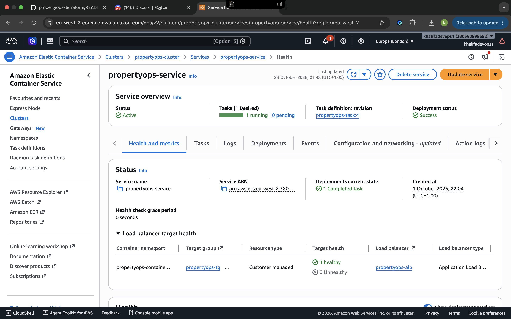
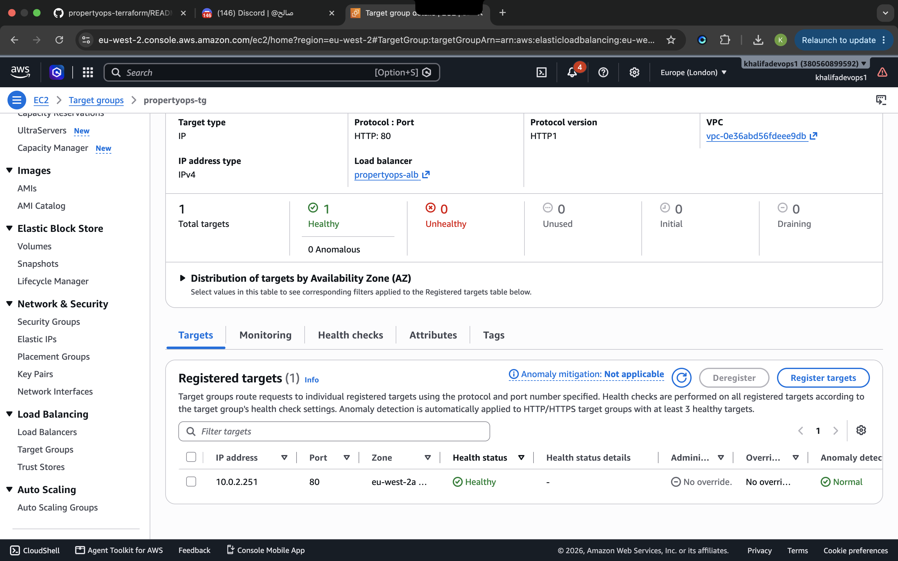
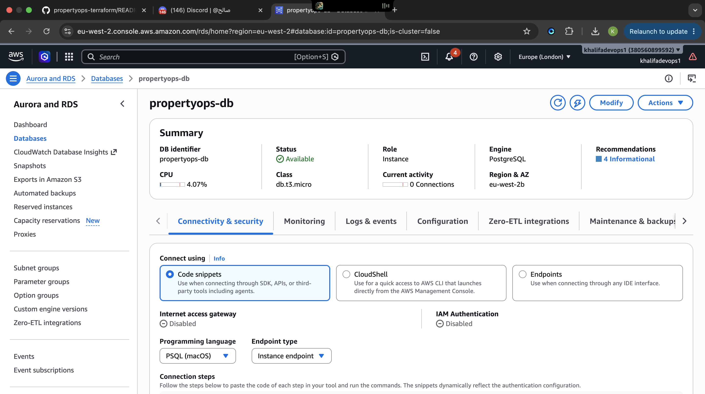
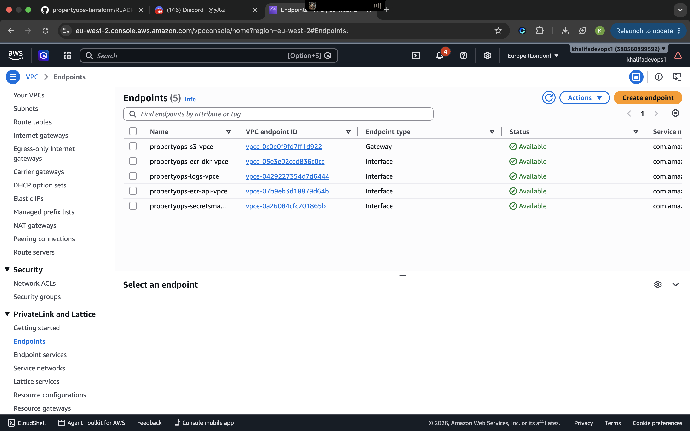
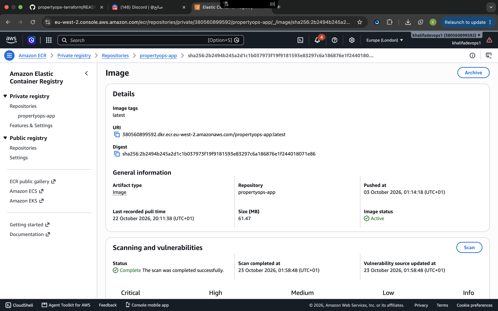
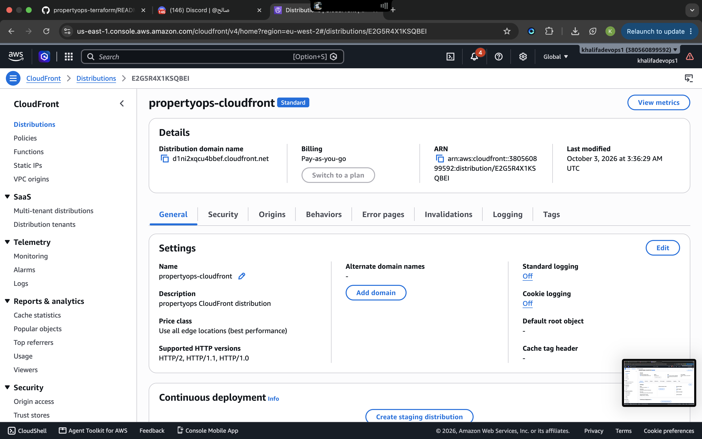
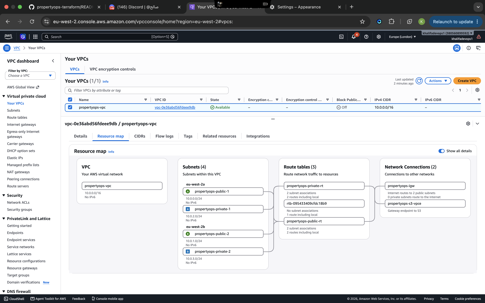
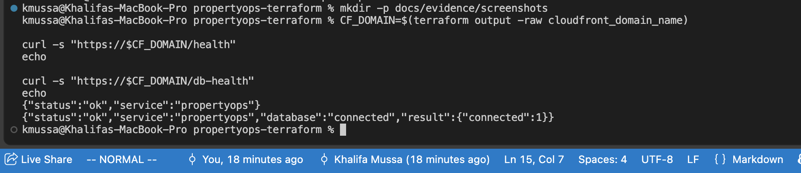

# PropertyOps Deployment Evidence

This page documents evidence from the live PropertyOps AWS environment before teardown.

The infrastructure was provisioned with Terraform in `eu-west-2` and validated end-to-end before the planned infrastructure teardown to control AWS costs.

---

## 1. ECS Fargate Service

The PropertyOps application runs as an Amazon ECS Fargate service inside private subnets.

Evidence captured from the live ECS service shows the workload running successfully.



Supporting CLI evidence:

[`ecs-service.txt`](evidence/ecs-service.txt)

---

## 2. Application Load Balancer Target Health

The Application Load Balancer forwards traffic to the ECS service.

The registered ECS target was confirmed as healthy.



---

## 3. Amazon RDS PostgreSQL

PropertyOps uses Amazon RDS PostgreSQL as its database.

The database is:

- deployed in private subnets
- not publicly accessible
- storage encrypted
- reachable only from the ECS security group on port `5432`



Supporting CLI evidence:

[`rds.txt`](evidence/rds.txt)

---

## 4. Private AWS Service Connectivity

ECS tasks run without public IP addresses.

Instead of using a NAT Gateway, PropertyOps uses VPC endpoints for private access to AWS services including:

- Amazon ECR API
- Amazon ECR Docker Registry
- Amazon CloudWatch Logs
- AWS Secrets Manager
- Amazon S3



Supporting CLI evidence:

[`vpc-endpoints.txt`](evidence/vpc-endpoints.txt)

---

## 5. Amazon ECR Container Image

The PropertyOps Node.js application was containerised with Docker and pushed to a private Amazon ECR repository.

The ECS task definition pulls the application image from ECR through private VPC connectivity.



---

## 6. Amazon CloudFront HTTPS

CloudFront provides the public HTTPS entry point for the development environment using the AWS-managed `cloudfront.net` hostname.

The request path is:

```text
Internet Client
      |
      | HTTPS
      v
Amazon CloudFront
      |
      | HTTP origin
      v
Application Load Balancer
      |
      v
Amazon ECS Fargate
```



For a production deployment, TLS would also be configured between CloudFront and the Application Load Balancer using a custom domain and ACM certificate.

---

## 7. VPC Network

The Terraform environment uses a VPC spanning two Availability Zones.

```text
VPC: 10.0.0.0/16

eu-west-2a
├── Public:  10.0.0.0/24
└── Private: 10.0.2.0/24

eu-west-2b
├── Public:  10.0.1.0/24
└── Private: 10.0.3.0/24
```

The Application Load Balancer runs in public subnets while ECS and RDS run in private subnets.



---

## 8. End-to-End Application Validation

Two application endpoints were tested through the public CloudFront HTTPS endpoint.

### Application health

```text
GET /health
```

Successful response:

```json
{
  "status": "ok",
  "service": "propertyops"
}
```

### Database health

```text
GET /db-health
```

Successful response:

```json
{
  "status": "ok",
  "service": "propertyops",
  "database": "connected",
  "result": {
    "connected": 1
  }
}
```

The successful database health check demonstrates the complete runtime path:

```text
CloudFront
    |
    v
Application Load Balancer
    |
    v
ECS Fargate
    |
    +------> AWS Secrets Manager
    |
    v
RDS PostgreSQL
```



Raw validation output:

[`application-health.txt`](evidence/application-health.txt)

---

## 9. Terraform Validation

Before teardown, Terraform was checked against the deployed environment.

Supporting files:

- [`terraform-plan.txt`](evidence/terraform-plan.txt)
- [`terraform-outputs.txt`](evidence/terraform-outputs.txt)

The final deployment was validated before the planned infrastructure teardown to control AWS costs.

---

## Evidence Summary

| Component | Validation |
|---|---|
| Terraform | Configuration deployed successfully |
| VPC | Public/private subnet architecture across two Availability Zones |
| ECS Fargate | Service running successfully |
| ALB | ECS target healthy |
| ECR | Application image stored privately |
| RDS PostgreSQL | Private and encrypted database |
| Secrets Manager | Database password injected securely |
| VPC Endpoints | Private AWS service connectivity |
| CloudFront | HTTPS public endpoint |
| `/health` | Application healthy |
| `/db-health` | PostgreSQL connection successful |

---

## Cost-Aware Design

PropertyOps was intentionally designed as a short-lived development and portfolio environment.

The architecture avoids NAT Gateways and instead uses VPC endpoints for required AWS service connectivity.

This reduces unnecessary networking costs while still allowing ECS tasks in private subnets to communicate with:

- Amazon ECR
- Amazon S3
- Amazon CloudWatch Logs
- AWS Secrets Manager

Resources such as RDS, ECS Fargate, the Application Load Balancer and interface VPC endpoints still generate ongoing charges while provisioned.

---

## Teardown Strategy

PropertyOps is designed to be reproducible through Terraform.

After collecting deployment evidence, the infrastructure can be removed using:

```bash
terraform destroy
```

This stops ongoing charges from resources such as:

- Amazon RDS
- ECS Fargate
- Application Load Balancer
- interface VPC endpoints
- CloudFront-related usage

The Terraform configuration remains the source of truth and can recreate the environment when required.

---

## Conclusion

The live deployment demonstrated a complete AWS application path from public HTTPS traffic through CloudFront and the Application Load Balancer to ECS Fargate, with private database connectivity to Amazon RDS PostgreSQL and secure credential retrieval through AWS Secrets Manager.

The environment was validated using:

- Terraform
- AWS CLI
- AWS Console
- application health endpoints
- database connectivity testing

The evidence in this directory preserves proof of the deployment even after the live infrastructure is intentionally destroyed for cost control.